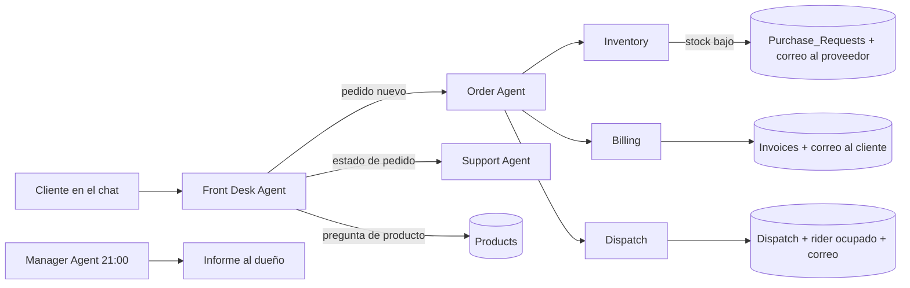

# Order to Delivery System

Sistema de pedido a entrega para un colmado dominicano ("Demo Traders"), construido con **n8n**, **Google Sheets**, **Gmail** y **Claude**. El cliente hace su pedido por chat y el sistema lo factura, descuenta el inventario, asigna un repartidor y avisa por correo. Cada noche el dueño recibe un informe.

La regla de diseño más importante: **el dinero no lo calcula la IA**. La IA solo entiende palabras. Un nodo Code toma los precios de la hoja `Products` y calcula los totales, así el mismo pedido da siempre el mismo total.

## Cómo funciona



## Los 7 flujos

| # | Flujo | IA | Qué hace |
|---|---|---|---|
| 1 | **Front Desk Agent** | Sí | Chat público con memoria de 10 mensajes. Reparte cada consulta y nunca inventa un precio. |
| 2 | **Order Agent** | Sí | Extrae artículos y datos del cliente con un Structured Output Parser. Un nodo Code calcula el total. Guarda `Customers` y `Orders` y llama a Inventory, Billing y Dispatch. |
| 3 | **Support Agent** | Sí | Responde "¿dónde está ORD-xxxx?" con herramientas de solo lectura sobre `Orders` y `Dispatch`. |
| 4 | **Manager Agent** | Sí | Informe a las 21:00 y formulario "Send report now". Un Code calcula ventas, stock bajo, facturas sin pagar y entregas tardías; la IA solo redacta el correo. |
| 5 | **Inventory** | No | Resta stock con Update Row por SKU. Si baja del mínimo, crea una fila en `Purchase_Requests` (4 × `Reorder_Level`) y escribe al proveedor. |
| 6 | **Billing** | No | Siguiente factura (`INV-1001`…), vencimiento a 7 días y aviso al cliente por correo o WhatsApp. Incluye el formulario "Record payment". |
| 7 | **Dispatch** | No | Primer repartidor con `Available = Yes`. Si no hay ninguno, el pedido espera y queda en el registro. Incluye el formulario "Mark delivered", que libera al repartidor y asigna el pedido en espera más antiguo. |

Y cinco flujos de apoyo:

| Flujo | IA | Qué hace |
|---|---|---|
| **Notify Customer** | No | Único punto de salida de los avisos al cliente (factura, "en camino", "entregado"). Manda correo si el cliente dejó uno; si no, guarda el mensaje como `whatsapp_pending` en `Activity_Log`, con el teléfono y el texto listos para enviar por WhatsApp. |
| **Inventory Control** | No | Dos formularios del personal: **movimientos de inventario** (entradas de mercancía con costo promedio, devoluciones, ajustes por conteo y mermas) y **cancelar pedido** (devuelve el stock, cancela la factura, libera al repartidor y avisa al cliente). Todo queda en el kardex. Ver [docs/inventario-y-contabilidad.md](docs/inventario-y-contabilidad.md). |
| **Create Order** | No | Núcleo compartido de pedidos: valida los datos, calcula los precios en código, guarda cliente y pedido y llama a Inventory, Billing y Dispatch. Lo usa la tienda web. |
| **Storefront** | No | Sirve la tienda web en `/webhook/tienda` y su API (`productos` y `pedido`). Detalles en [docs/tienda.md](docs/tienda.md). |
| **Seed Data** | No | Carga 50 productos típicos de colmado y 3 repartidores. Se puede repetir sin duplicar filas. |

Todos los flujos escriben en `Activity_Log`.

## Estructura del repositorio

```
workflows/   Exportación JSON de los 12 flujos de n8n
storefront/  Tienda web (index.html) y el script que la empaqueta en n8n
data/        Productos y repartidores de ejemplo, y estructura de la hoja
tools/       Scripts que generan los flujos de n8n a partir de código
docs/        Instalación, Google Cloud, tienda web, inventario y contabilidad, hoja de ruta y pruebas
```

## Inventario y contabilidad

El inventario baja al **confirmar** cada pedido y cada cambio de stock deja una fila en el kardex (`Inventory_Movements`), con tipo, cantidad, saldo, costo y referencia. Hay costo por producto (costo promedio ponderado), valor del inventario, costo de ventas y margen. El informe diario del dueño trae el resumen contable. Detalles y limitaciones en [docs/inventario-y-contabilidad.md](docs/inventario-y-contabilidad.md).

## Tienda web

Con n8n encendido, la tienda está en `http://localhost:5678/webhook/tienda`: catálogo con 50 productos por categorías, buscador, carrito editable, datos de entrega, forma de pago y pantalla de confirmación. El navegador solo envía códigos y cantidades; **el total lo calcula el servidor**. Más detalles en [docs/tienda.md](docs/tienda.md).

## Puesta en marcha

1. **Hoja de cálculo**: crea un Google Sheet con las 9 pestañas de [data/sheet-headers.md](data/sheet-headers.md).
2. **Google Cloud**: crea las credenciales OAuth siguiendo [docs/google-cloud.md](docs/google-cloud.md).
3. **n8n**: crea estas credenciales:
   - Google Sheets OAuth2 y Gmail OAuth2.
   - Anthropic (tu API key).
   - Basic Auth para los formularios del personal.
4. **Importa** los JSON de `workflows/` en este orden: Notify Customer, Inventory, Billing, Dispatch, Inventory Control, Create Order, Storefront, Support Agent, Order Agent, Front Desk Agent, Manager Agent, Seed Data.
5. **Reconecta las referencias** (los IDs cambian al importar):
   - En cada nodo de Google Sheets: elige tu hoja y tus credenciales.
   - En Order Agent y en Create Order: los nodos `Call Inventory`, `Call Billing` y `Call Dispatch`.
   - En Billing y Dispatch: los nodos `Notify invoice`, `Notify on the way` y `Notify delivered`.
   - En Storefront: el nodo `Run Create Order`.
   - En Front Desk Agent: las herramientas `Order agent` y `Support agent`.
   - En Dispatch: el nodo `Assign waiting order`, que se llama a sí mismo.
6. **Correos de ejemplo**: cambia `proveedor@example.com` y el correo del dueño en el nodo `Compute report numbers` del Manager Agent.
7. **Zona horaria**: los flujos usan `America/Santo_Domingo`. Cámbiala en los ajustes de cada flujo si hace falta.
8. Ejecuta **Seed Data** una vez y **publica** los flujos.

## Formularios del personal

Los tres formularios están protegidos con Basic Auth y son locales a tu instancia de n8n:

| Formulario | Ruta | Quién lo usa |
|---|---|---|
| Record payment | `/form/demo-traders-record-payment` | Caja |
| Mark delivered | `/form/demo-traders-mark-delivered` | Repartidores |
| Send report now | `/form/demo-traders-send-report` | Dueño |
| Movimiento de inventario | `/form/demo-traders-stock-movement` | Almacén |
| Cancelar pedido | `/form/demo-traders-cancel-order` | Caja o dueño |

Para usarlos desde el móvil, n8n debe ser accesible desde internet (túnel o servidor).

## Limitaciones conocidas

- **Cuota de Google Sheets**: 60 lecturas por minuto. Un pedido gasta unas 25, por eso los nodos de Sheets tienen reintentos. Para más volumen, pasa los datos a una base de datos real.
- **Pedidos simultáneos**: dos pedidos en el mismo segundo pueden chocar en el número, porque Sheets no tiene transacciones.
- **Google en modo Prueba**: los tokens caducan cada 7 días. Para publicar la app Google exige un dominio propio con página principal y política de privacidad.
- **WhatsApp todavía no está conectado.** El correo es opcional y el teléfono es el dato obligatorio, pensando en clientes que no usan correo. Mientras no haya WhatsApp, los avisos de un cliente sin correo quedan como `whatsapp_pending` en `Activity_Log`; nadie los recibe hasta que se conecte Evolution API (pruebas) o la API oficial de Meta (producción) en el flujo Notify Customer.
- **Cadena sin transacciones**: si un paso falla a mitad de un pedido (por ejemplo, Dispatch), el pedido queda facturado sin repartidor. El informe del dueño no lo marca todavía.

## Seguridad

Este repositorio **no contiene** contraseñas, API keys ni secretos de OAuth. Los flujos solo guardan referencias a credenciales de n8n por nombre. Los correos reales se sustituyeron por `@example.com`.
