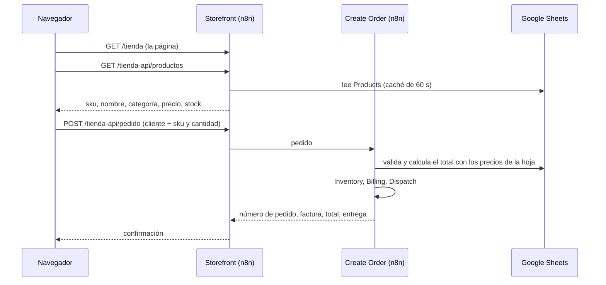

# Tienda web

Una página de compra servida por n8n, sin servidor adicional. Es un primer concepto para seguir desarrollando.

## Direcciones (con n8n local)

| Qué | Dirección |
|---|---|
| Tienda | `http://localhost:5678/webhook/tienda` |
| API de productos (GET) | `http://localhost:5678/webhook/tienda-api/productos` |
| API de pedidos (POST) | `http://localhost:5678/webhook/tienda-api/pedido` |

## Qué hace la página

- Catálogo de 50 productos con categorías, buscador y avisos de "Agotado" y "Quedan N".
- Carrito editable: sumar, restar y quitar productos. Se guarda en el navegador y sobrevive a recargar la página.
- Pago en tres pasos (carrito, datos y pago, confirmación) con validación de los datos. El **teléfono (WhatsApp) es obligatorio y el correo es opcional**.
- Formas de pago: efectivo contra entrega activo. Transferencia y tarjeta aparecen como "Próximamente".
- Tres botones en la cabecera (Entrega a domicilio, Pago contra entrega, Avisos por WhatsApp) que abren una ventana explicando cómo funciona cada cosa y qué falta por activar.
- Pantalla final con número de pedido, factura, total y estado de la entrega.
- Diseño adaptable a móvil, accesible con teclado y sin librerías externas.

Las "imágenes" de producto son ilustraciones (emoji sobre un fondo por categoría). Las fotos reales llegarán con una columna `Image_URL` en `Products`.

## Cómo funciona

## Decisiones de diseño

- **El total nunca viene del navegador.** El navegador solo envía códigos y cantidades. Los precios y el total salen de `Products` en el nodo `Validate and price`.
- **Caché de 60 segundos** de la lista de productos, para que muchas visitas no agoten la cuota de Google Sheets (60 lecturas por minuto).
- **Solo datos públicos**: la API de productos no expone el correo del proveedor ni el nivel de reposición.
- **Trampa para bots** (honeypot): un campo oculto que un humano no llena. Si llega con contenido, la solicitud se descarta.
- **Un solo núcleo de pedidos**: la tienda y, más adelante, el chat y WhatsApp pueden usar el flujo `Create Order`.

## Editar la página

El código fuente es `storefront/index.html`. Para publicar un cambio:

1. Edita `storefront/index.html`.
2. Ejecuta `python storefront/build-workflow.py storefront/index.html storefront-workflow.json <ID de Create Order>`.
3. Importa `storefront-workflow.json` en n8n y publícalo.

## Limitaciones actuales

- No hay límite de pedidos por visitante: una página pública puede recibir pedidos falsos. Antes de salir a internet hay que añadir límites de uso y una verificación (por ejemplo Cloudflare Turnstile).
- El stock se descuenta al confirmar el pedido, no al agregar al carrito. Dos clientes pueden querer el último producto y el segundo recibirá un aviso de existencia insuficiente.
- No hay cuentas de cliente ni historial de pedidos.
- La pantalla de confirmación y el botón "Avisos por WhatsApp" prometen avisos por WhatsApp, pero WhatsApp aún no está conectado. Hasta entonces, un cliente sin correo no recibe los avisos y solo ve su número de pedido en pantalla. El aviso queda guardado como `whatsapp_pending` en `Activity_Log`.
